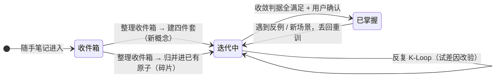
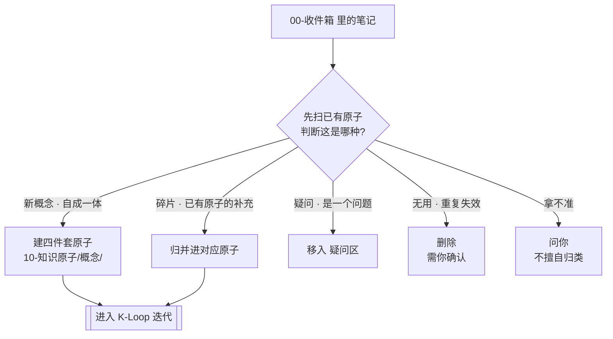
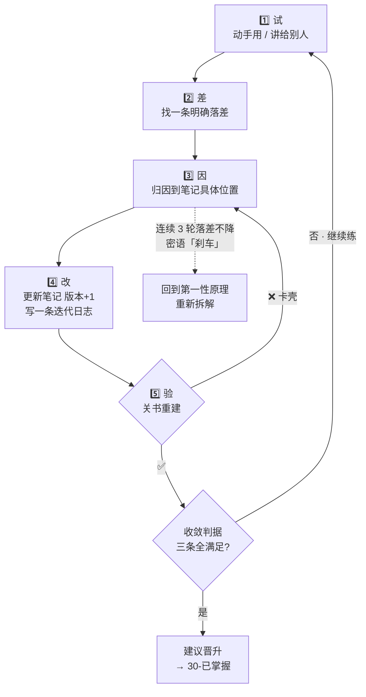

# 🗺 知识迭代 · 流程图

> 乱的时候回来看这里。**每个知识原子的一生只有三种状态，来回也就三条路。**
> 完整方法论见 [[知识迭代协议]]。

---

## 一、总览：知识原子的一生（三状态）

> 读法：**横轴是时间**。笔记出生在收件箱 → 被整理进迭代区 → 在迭代区反复"训练" → 考过了晋升到已掌握；哪天被现实打脸（遇到反例），再丢回去重训。



| 状态 | 位置 | 含义 |
| :-- | :-- | :-- |
| 📥 收件箱 | `00-收件箱/` | 未入环的原料，还没开始训练 |
| 🧬 迭代中 | `10-知识原子/<概念>/` | 四件套在此，反复迭代"长身体" |
| 🏆 已掌握 | `30-已掌握/<概念>/` | 考过收敛判据，归档（四件套保留） |

---

## 二、入口：收件箱 → 入环（「整理收件箱」skill 怎么分类）



> 铁律：**归并优先于新建**，避免知识原子越拆越碎。

---

## 三、核心循环：K-Loop 一轮（细看）



**收敛判据（要全满足才晋升）：**
1. 重建稿**连续 2 次 ✅** 且零参考
2. 压缩版**一页纸、准确无损**
3. 教授稿**新手能复述**

> 回跳规则速记：
> - 重建 ❌ → 回第 3️⃣ 步「因」重新归因
> - 收敛不满足 → 回第 1️⃣ 步继续练
> - 落差不降 3 轮 → 密语「刹车」→ 回第一性原理拆解
> - 某轮跳了步骤 → 密语「违规」→ 回退缺口重做

---

## 四、文字版兜底（Mermaid 不渲染时看这个）

```
随手记 ──► 00-收件箱（捕获区）
              │ 「整理收件箱」分类
              ├─ 新概念 ──► 建四件套 ──────────┐
              ├─ 碎片   ──► 归并到已有原子 ─────┤
              ├─ 疑问   ──► 移入 疑问区         │
              └─ 无用   ──► 删除（需确认）      │
                                              ▼
                             10-知识原子/概念/  ◄─────┐
                                   │                  │ 重建 ❌
                                   ▼                  │
                        K-Loop：试 → 差 → 因 → 改 → 验 ┘
                                   │ 重建 ✅
                                   ▼
                          收敛判据 三条全满足？
                                   │ 否 → 回去继续迭代
                                   │ 是 + 你确认
                                   ▼
                        30-已掌握/概念/ ── 遇到反例 → 丢回 00-收件箱 重训
```

---

## 五、什么时候"动"？转移条件速查

| 从 | 到 | 触发条件 | 谁执行 |
| :-- | :-- | :-- | :-- |
| `00-收件箱` | `10-知识原子` | 「整理收件箱」分类并确认 | AI 建议 + 你确认 |
| `10-知识原子` | `10-知识原子`（版本+1） | 一轮 K-Loop 完成 | AI 更新 + 你提供落差 |
| `10-知识原子` | `30-已掌握` | 三条收敛判据全满足 | AI 建议 + 你确认 |
| `30-已掌握` | `10-知识原子` | 遇到反例 / 新场景 | 你触发（文件夹移回去） |

> 记忆口诀：**收件箱 → 迭代区 → 已掌握**，来回路就三条——**入环、晋升、回炉**。
